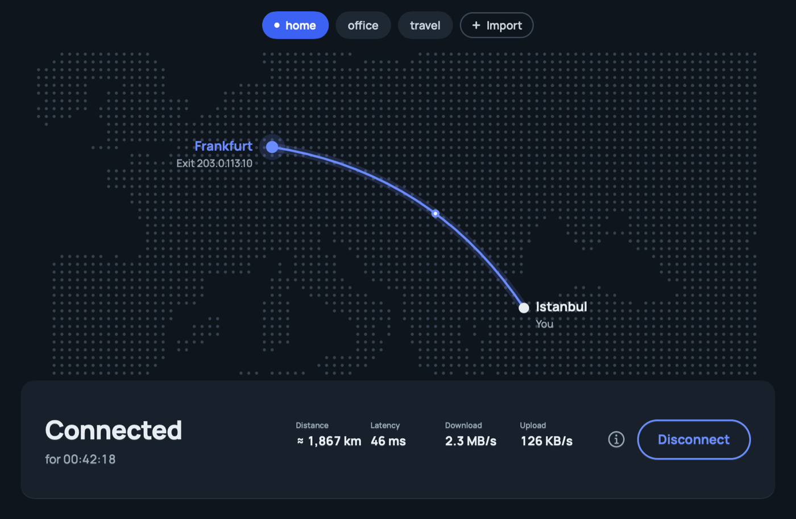
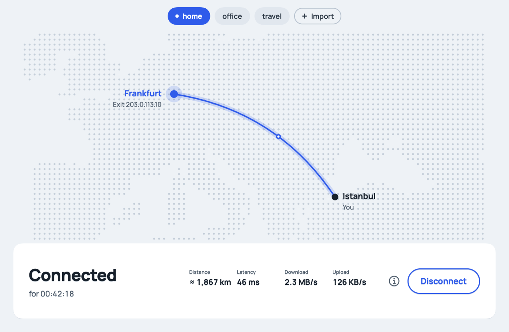
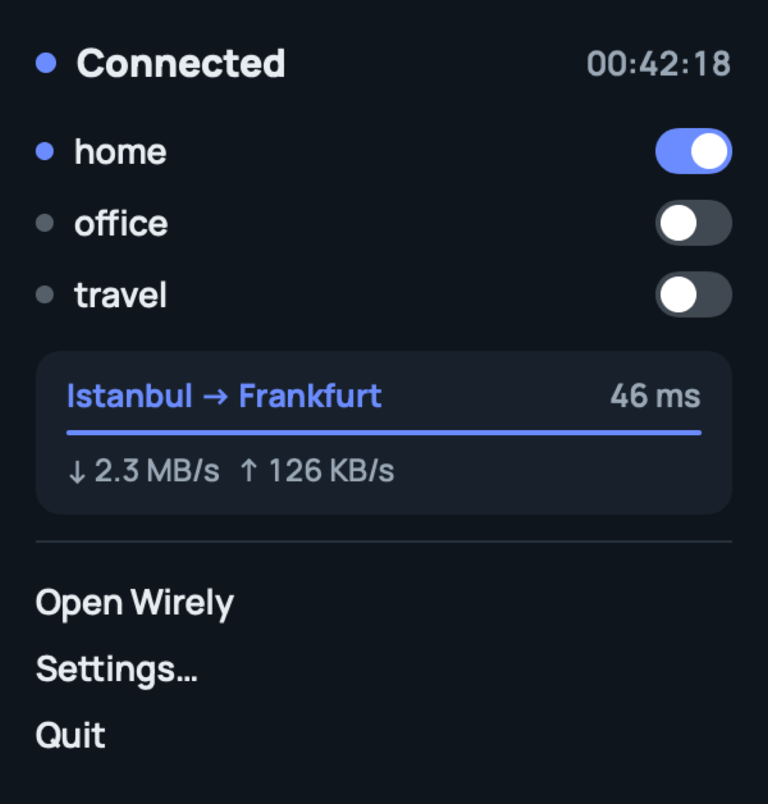
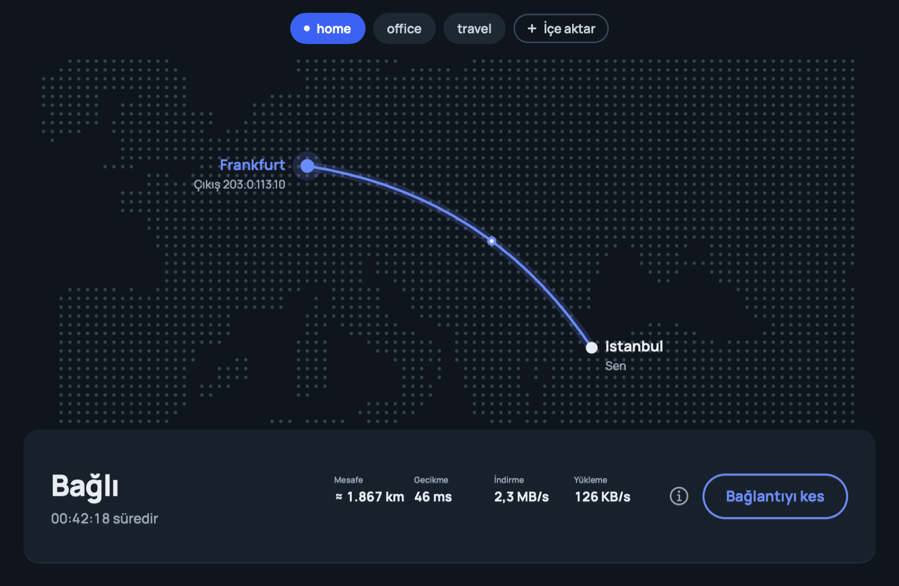

<p align="center">
  
</p>

<h1 align="center">Wirely</h1>

<p align="center">
  A small, good-looking WireGuard client for macOS.<br>
  Import your <code>.conf</code>, see where your traffic exits on a map, connect with one click.
</p>

<p align="center">
  <a href="https://github.com/luucas42/wirely/releases/latest"><b>Download</b></a> ·
  <a href="#install">Install</a> ·
  <a href="#how-it-works">How it works</a> ·
  <a href="#build-from-source">Build</a> ·
  <a href="#türkçe">Türkçe</a>
</p>

<p align="center">
  
</p>

## Why

The official WireGuard app is great — when you can install it. Wirely is for the Macs where you can't (no App Store account, region restrictions, managed Apple IDs), and for people who want to *see* their tunnel: where it leaves, where it exits, whether the server is answering.

It runs the same userspace implementation the official app uses ([wireguard-go](https://git.zx2c4.com/wireguard-go/)), configured the way `wg-quick` does it.

## Features

- **Standard WireGuard profiles** — drop in `.conf` files, several at once, or the `.zip` from the official app's *Export Tunnels to Zip*.
- **Route map** — your city (from the Mac's time zone, offline) to the server's city, with distance, latency through the tunnel and live throughput.
- **One tunnel at a time, one click** — profile chips across the top; switching profiles hands over cleanly.
- **Honest status** — if the server stops answering (no handshake), the arc breaks and Wirely tells you the network may be blocking WireGuard.
- **Notifications** for connected, dropped, no response and restored — never for a disconnect you clicked.
- **Menu bar** panel with a toggle per profile.
- **No leaks by default** — full-tunnel profiles route everything; if a profile has no IPv6 address, IPv6 is blocked instead of leaking around the tunnel.
- **Survives network changes** — Wi-Fi switches and sleep/wake re-point the server route automatically.
- **English and Türkçe**, switchable instantly in Settings. Light and dark mode.

<p align="center">
  
  
</p>

## Install

Requirements: a Mac with **Apple Silicon** running **macOS 13 or later**, and an **administrator** account (needed once, to install the background service).

1. Download `Wirely-<version>.dmg` from [Releases](https://github.com/luucas42/wirely/releases/latest), open it and drag **Wirely** to **Applications**.
2. **First launch.** Wirely is not notarized by Apple, so macOS stops it the first time:
   - Double-click Wirely. You'll see *“Wirely” Not Opened — Apple could not verify…*. Click **Done** (not *Move to Trash*).
   - Open **System Settings → Privacy & Security**, scroll down, click **Open Anyway**, confirm with your password or Touch ID, then **Open**.
   - On macOS 15 and later, right-click → Open no longer skips this.
   - Terminal alternative: `xattr -dr com.apple.quarantine /Applications/Wirely.app`
3. **Install the service.** Click **Install service** in the app and enter your Mac password. You won't be asked again until the service is updated.
   - macOS may show *Background item added* — that's Wirely's service. It's listed in **System Settings → General → Login Items & Extensions**.
4. **Add a profile** (drag a `.conf` into the window or click **Import**) and press **Connect**.

> [!IMPORTANT]
> Use one profile per person and device. WireGuard identifies peers by key: if the same profile is connected on two Macs, they keep knocking each other offline.

### Uninstall

**Wirely → Settings → Service → Uninstall service**, then move the app to the Trash. Your profiles are in `~/Library/Application Support/Wirely/Tunnels/` if you want to delete them too.

## How it works

```
┌──────────────────────┐   Unix socket (JSON)   ┌───────────────────────────────┐
│ Wirely.app (SwiftUI) │ ─────────────────────▶ │ wirely-helper (root daemon)   │
│ profiles, map, UI    │ ◀───────────────────── │ ├─ wireguard-go  → utunN       │
└──────────────────────┘   status every second  │ ├─ ifconfig / route (routes)  │
                                                │ └─ networksetup (DNS)         │
                                                └───────────────────────────────┘
```

- Creating a tunnel interface and changing routes and DNS needs root. Without an Apple Developer account there is no Network Extension, so Wirely installs a small **LaunchDaemon** once (with your password) and talks to it over `/var/run/wirely-helper.sock`.
- The helper starts `wireguard-go`, configures it over its UAPI socket, then does what `wg-quick` does on macOS: interface address and MTU, `0.0.0.0/1` + `128.0.0.0/1` routes for full tunnels, a host route to the server through your real gateway, and the profile's DNS servers.
- On disconnect everything is restored exactly — routes, DNS (per network service) and the IPv6 block. State is written to disk before each change, so if the helper crashes, the next start cleans up.
- The tunnel lives in the helper: quitting the app keeps you connected.

### Security and privacy

- The socket only accepts the user who installed the service (checked with `getpeereid`) and root.
- Every system command is run with an argument list, never through a shell. `PreUp` / `PostUp` / `PreDown` / `PostDown` lines in profiles are **ignored**, not executed.
- Profiles are stored with `0600` permissions. Private keys never appear in the helper log (`/Library/Logs/Wirely/helper.log`).
- **Location lookups:** your own city comes from the system time zone — nothing is sent anywhere. The *server's* city is looked up once per server IP via [ipwho.is](https://ipwho.is) (fallback [ipinfo.io](https://ipinfo.io)) and cached for 30 days. Private addresses are never looked up.
- DNS changes are applied only to real network services (Wi-Fi, Ethernet…), never to other VPN apps' services.

### Limitations

- Apple Silicon only; not notarized (see *First launch*).
- One active tunnel at a time. No kill switch or on-demand rules yet.
- Plain WireGuard only — obfuscated variants such as AmneziaWG are not supported.

## Build from source

Built and tested with Xcode 27.1 (Swift 6.4) on macOS 26; the package declares `swift-tools-version:6.0` and uses Swift 5 language mode.

```sh
brew install wireguard-go      # the bundled userspace WireGuard binary
swift test                     # unit tests (parsing, routing/DNS planning, tunnel orchestration, UI logic)
scripts/build-app.sh           # → build/Wirely.app (ad-hoc signed)
scripts/make-dmg.sh            # → dist/Wirely-<version>.dmg
```

`build/Wirely.app/Contents/MacOS/Wirely --render-previews /tmp/previews` renders every UI state (light, dark, Turkish) to PNGs without connecting anything — handy for reviewing UI changes.

```
Sources/WirelyCore/        config parser, UAPI, route/DNS planning, app↔helper protocol
Sources/WirelyHelperKit/   helper: tunnel orchestration, wireguard-go, socket server
Sources/wirely-helper/     helper executable (daemon / ctl / cleanup)
Sources/WirelyApp/         SwiftUI app: models, map, views, localisation, notifications
Sources/Wirely/            app entry point
scripts/                   build, DMG, icon and land-mask generators
```

Contributions are welcome — see [CONTRIBUTING.md](CONTRIBUTING.md).

## Credits

- [wireguard-go](https://git.zx2c4.com/wireguard-go/) — MIT, © WireGuard LLC ([license](Resources/ThirdParty/wireguard-go-LICENSE))
- [Manrope](https://github.com/googlefonts/manrope) — SIL Open Font License 1.1 ([license](Resources/ThirdParty/Manrope-OFL.txt))
- [Natural Earth](https://www.naturalearthdata.com/) 1:50m land data — public domain, rasterised by `scripts/make-landmask.swift`
- Server location: [ipwho.is](https://ipwho.is), [ipinfo.io](https://ipinfo.io)

"WireGuard" and the WireGuard logo are registered trademarks of Jason A. Donenfeld. Wirely is an independent project and is not affiliated with or endorsed by WireGuard.

Wirely is released under the [MIT License](LICENSE).

---

## Türkçe

**Wirely**, Mac için sade ve şık bir WireGuard istemcisi. `.conf` dosyanı içe aktarırsın, trafiğinin nereden çıktığını haritada görürsün, tek tıkla bağlanırsın. Arayüz varsayılan olarak İngilizce; **Ayarlar → Genel → Dil** bölümünden anında Türkçeye geçebilirsin.

<p align="center">
  
</p>

**Kurulum**

1. [Releases](https://github.com/luucas42/wirely/releases/latest) sayfasından `Wirely-<sürüm>.dmg` dosyasını indir, aç ve Wirely'yi **Uygulamalar** klasörüne sürükle. (Apple Silicon ve macOS 13+ gerekir.)
2. **İlk açılış:** Uygulama Apple tarafından onaylanmadığı için macOS ilk seferde engeller. Wirely'ye çift tıkla, *“Wirely” açılmadı* uyarısında **Bitti**'ye bas (*Çöp Sepetine Taşı*'yı seçme). **Sistem Ayarları → Gizlilik ve Güvenlik** bölümünü aç, aşağı kaydır, **Yine de Aç**'a bas, parola veya Touch ID ile onayla, sonra **Aç**. (Terminal'den: `xattr -dr com.apple.quarantine /Applications/Wirely.app`)
3. **Servisi kur:** Uygulamada **Servisi kur**'a bas ve Mac parolanı gir (bir kez; hesabın yönetici olmalı). macOS "Arka plan öğesi eklendi" bildirimi gösterebilir — bu Wirely'nin servisidir.
4. Profil eklemek için `.conf` dosyasını pencereye sürükle ya da **İçe aktar**'a bas, ardından **Bağlan**.

> Her kişi kendi profilini kullanmalı: aynı profil iki Mac'te aynı anda bağlanırsa ikisi de bağlantıdan düşer.

Kaldırmak için: **Ayarlar → Servis → Servisi kaldır**, sonra uygulamayı Çöp Sepeti'ne at.
