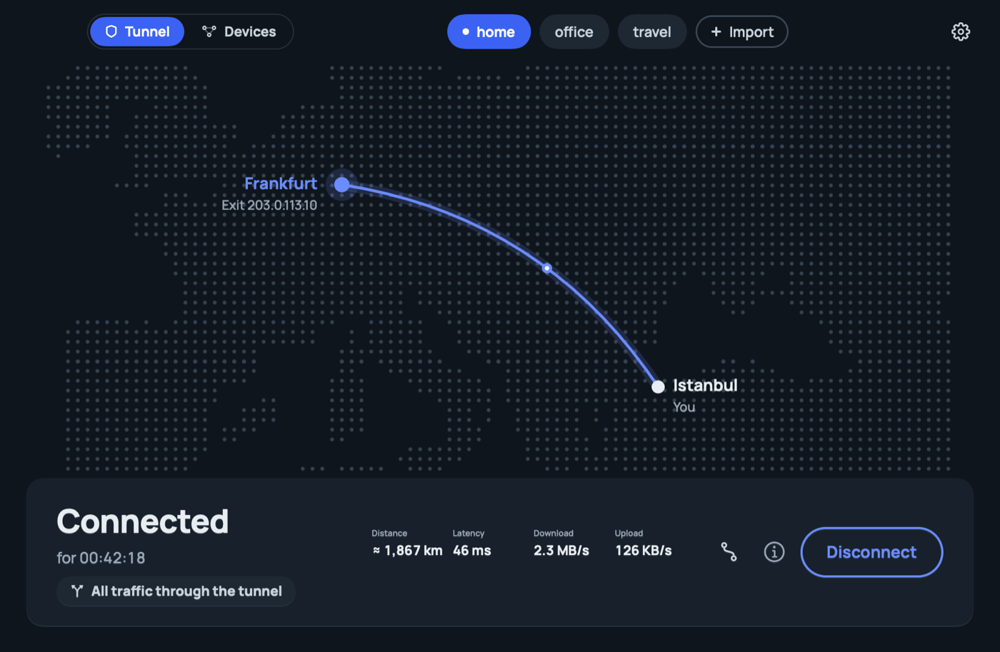
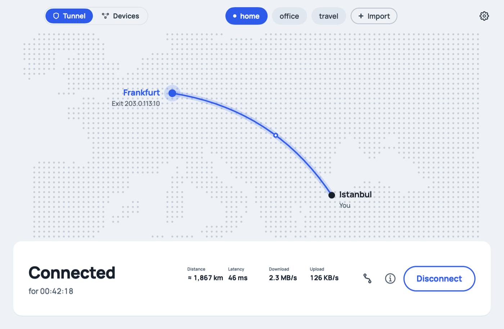
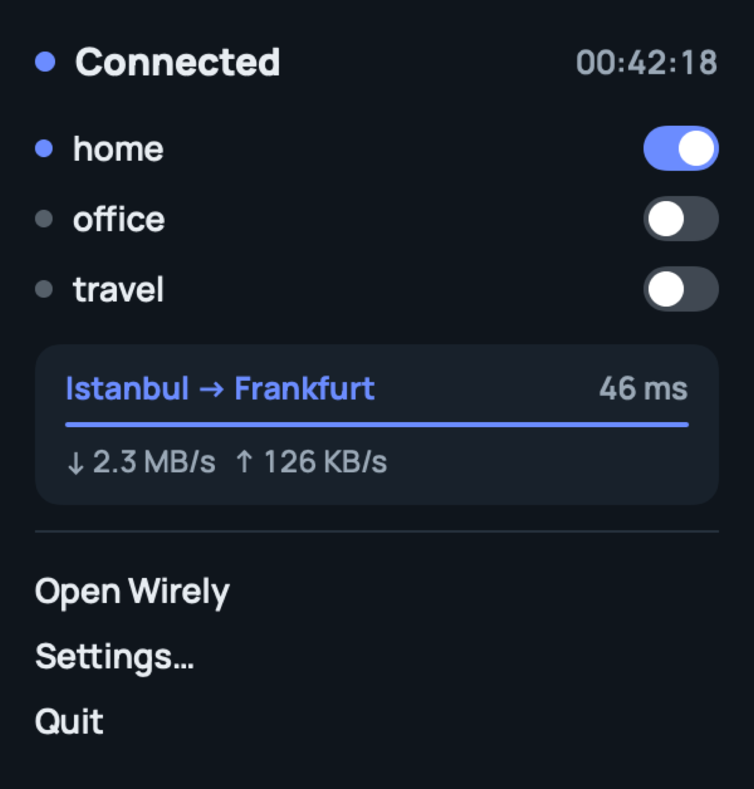
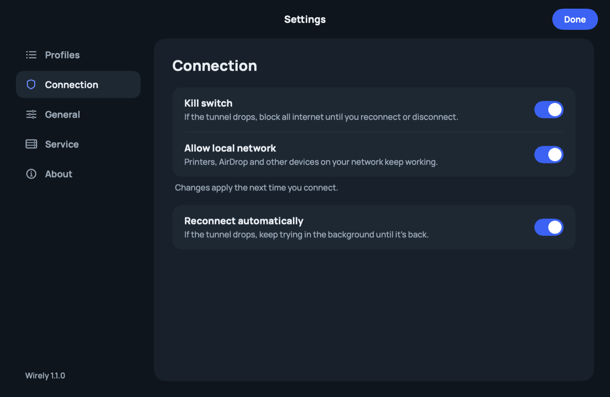
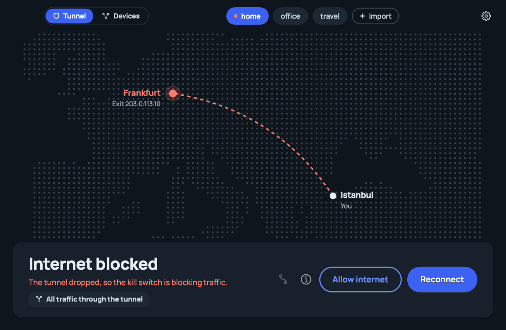
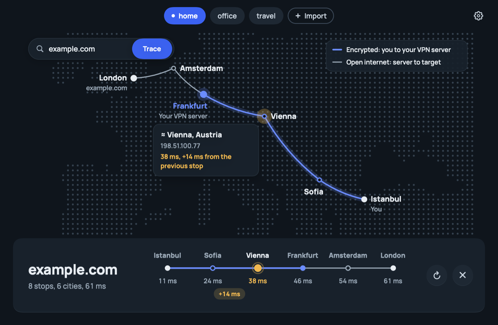
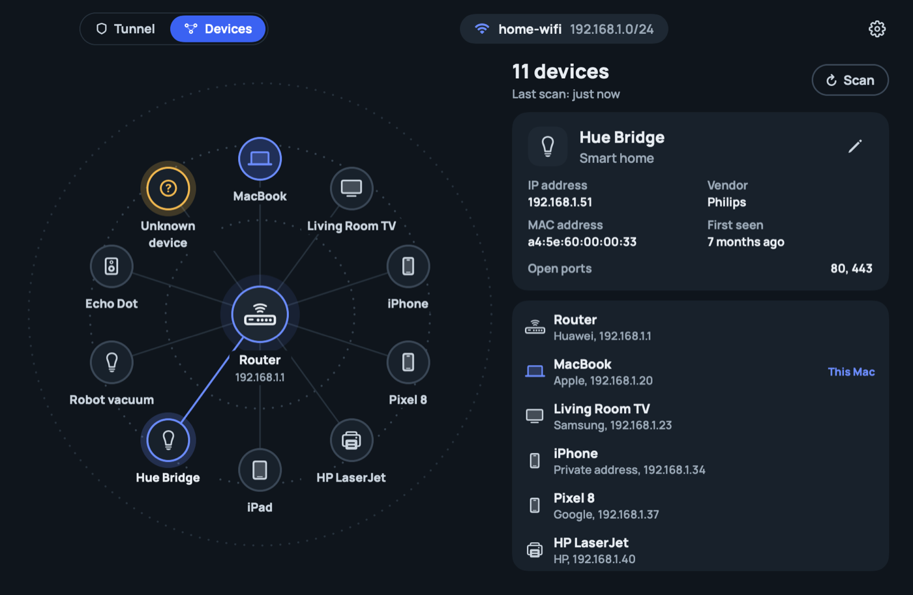
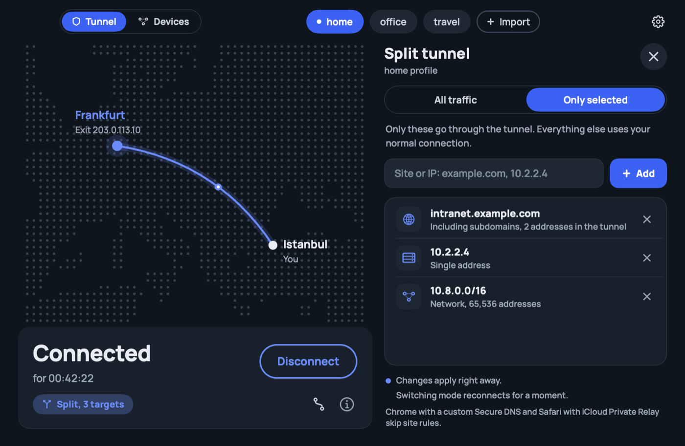
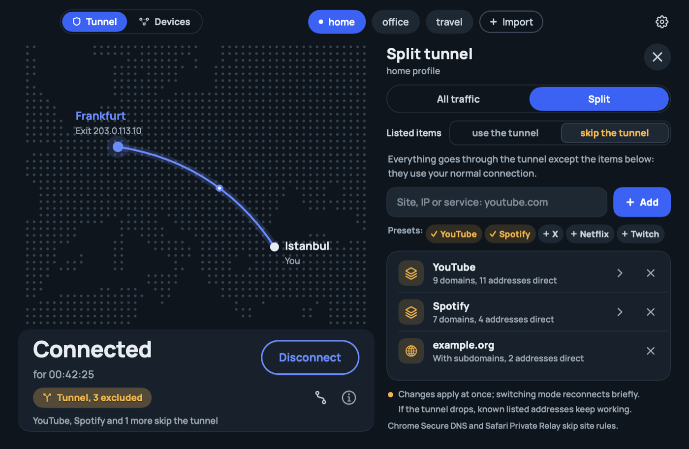
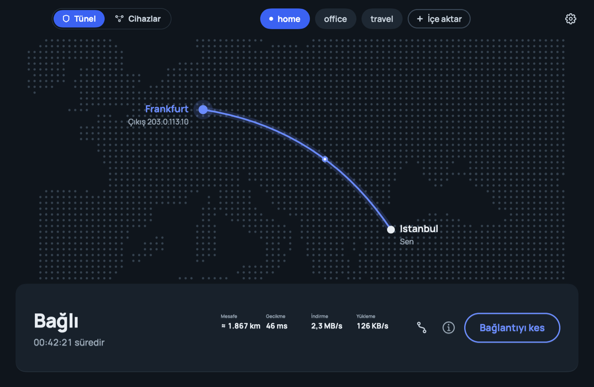

<p align="center">
  
</p>

<h1 align="center">Wirely</h1>

<p align="center">
  A small, good-looking WireGuard client for macOS.<br>
  Import your <code>.conf</code>, see where your traffic exits on a map, connect with one click.
</p>

<p align="center">
  <a href="https://github.com/luucas42/wirely/releases/latest"><b>Download</b></a> ·
  <a href="#install">Install</a> ·
  <a href="#how-it-works">How it works</a> ·
  <a href="#build-from-source">Build</a> ·
  <a href="#türkçe">Türkçe</a>
</p>

<p align="center">
  
</p>

## Why

The official WireGuard app is great — when you can install it. Wirely is for the Macs where you can't (no App Store account, region restrictions, managed Apple IDs), and for people who want to *see* their tunnel: where it leaves, where it exits, whether the server is answering.

It runs the same userspace implementation the official app uses ([wireguard-go](https://git.zx2c4.com/wireguard-go/)), configured the way `wg-quick` does it.

## Features

- **Standard WireGuard profiles** — drop in `.conf` files, several at once, or the `.zip` from the official app's *Export Tunnels to Zip*.
- **Route map** — your city (from the Mac's time zone, offline) to the server's city, with distance, latency through the tunnel and live throughput.
- **One tunnel at a time, one click** — profile chips across the top; connecting takes about a quarter of a second and switching profiles hands over cleanly.
- **Honest status** — if the server stops answering (no handshake), the arc breaks and Wirely tells you the network may be blocking WireGuard.
- **Notifications** for connected, dropped, no response and restored — never for a disconnect you clicked.
- **Menu bar** panel with a toggle per profile.
- **No leaks by default** — full-tunnel profiles route everything; if a profile has no IPv6 address, IPv6 is blocked instead of leaking around the tunnel.
- **Kill switch** — if the tunnel drops, all internet traffic is blocked until you reconnect or click *Allow internet*, so nothing slips out over your normal connection. On by default; printers, AirDrop and other local devices keep working. [More below](#kill-switch).
- **Survives network changes** — Wi-Fi switches and sleep/wake re-point the server route automatically.
- **Route on the map** — trace the path to your VPN server or any site in about a second: every stop on the map, the encrypted part and the open-internet part drawn differently, and the stop where latency jumps. [More below](#route-trace).
- **Devices on your network** — a map of everything on your Wi-Fi or Ethernet with the router in the middle, with names, kinds and vendors, an open-port check on request, and a notification when a device you haven't seen before joins. [More below](#devices).
- **Split tunnel** — per profile, either send only the sites and IPs you pick through the tunnel, or send everything through it except the ones you list (with one-click presets for YouTube, Spotify, X, Netflix and Twitch); add or remove them while connected. [More below](#split-tunnel).
- **Reconnects by itself** — if the tunnel drops, Wirely retries in the background (right away after sleep or when the network comes back) until it's up again.
- **Settings that look like the app** — profiles (edit, rename, export, delete), connection, language, notifications, open at login and connect on launch, all on one page inside the window (⌘,).
- **Tells you about updates** — once a day it checks GitHub for a new release and shows what's new in the app.
- **English and Türkçe**, switchable instantly in Settings. Light and dark mode.

<p align="center">
  
  
</p>

<p align="center">
  
</p>

## Install

Requirements: a Mac with **Apple Silicon** running **macOS 13 or later**, and an **administrator** account (needed once, to install the background service).

1. Download `Wirely-<version>.dmg` from [Releases](https://github.com/luucas42/wirely/releases/latest), open it and drag **Wirely** to **Applications**.
2. **First launch.** Wirely is not notarized by Apple, so macOS stops it the first time:
   - Double-click Wirely. You'll see *“Wirely” Not Opened — Apple could not verify…*. Click **Done** (not *Move to Trash*).
   - Open **System Settings → Privacy & Security**, scroll down, click **Open Anyway**, confirm with your password or Touch ID, then **Open**.
   - On macOS 15 and later, right-click → Open no longer skips this.
   - Terminal alternative: `xattr -dr com.apple.quarantine /Applications/Wirely.app`
3. **Install the service.** Click **Install service** in the app and enter your Mac password. You won't be asked again until the service is updated.
   - macOS may show *Background item added* — that's Wirely's service. It's listed in **System Settings → General → Login Items & Extensions**.
4. **Add a profile** (drag a `.conf` into the window or click **Import**) and press **Connect**.
5. **Local Network prompt.** The first time you open **Devices**, macOS asks whether Wirely may find devices on your local network. Click **Allow**; the VPN itself doesn't need it.

> [!IMPORTANT]
> Use one profile per person and device. WireGuard identifies peers by key: if the same profile is connected on two Macs, they keep knocking each other offline.

### Update

From 1.2 on, Wirely tells you when a new version is out (**Settings → About** shows what's new and a **Download** button).

1. Quit Wirely (menu bar icon → **Quit**), download the new DMG and drag **Wirely** to **Applications**, choosing **Replace**. Your profiles and settings are kept.
2. Open it. macOS may ask you to approve it again, as in *First launch*.
3. If the app says *A service update is required*, click **Update** and enter your Mac password. This restarts the service, so an active tunnel is disconnected; connect again afterwards.

### Uninstall

**Wirely → Settings → Service → Uninstall service**, then move the app to the Trash. Your profiles are in `~/Library/Application Support/Wirely/Tunnels/` if you want to delete them too.

## How it works

```
┌──────────────────────┐   Unix socket (JSON)   ┌───────────────────────────────┐
│ Wirely.app (SwiftUI) │ ─────────────────────▶ │ wirely-helper (root daemon)   │
│ profiles, map, UI    │ ◀───────────────────── │ ├─ wireguard-go  → utunN      │
└──────────────────────┘   status every second  │ ├─ ifconfig / route (routes)  │
                                                │ ├─ SystemConfiguration (DNS)  │
                                                │ ├─ pfctl (kill switch)        │
                                                │ └─ UDP probes (route trace)   │
                                                └───────────────────────────────┘
```

- Creating a tunnel interface and changing routes and DNS needs root. Without an Apple Developer account there is no Network Extension, so Wirely installs a small **LaunchDaemon** once (with your password) and talks to it over `/var/run/wirely-helper.sock`.
- The helper starts `wireguard-go`, configures it over its UAPI socket, then does what `wg-quick` does on macOS: interface address and MTU, `0.0.0.0/1` + `128.0.0.0/1` routes for full tunnels, a host route to the server through your real gateway, and the profile's DNS servers (written through SystemConfiguration in one change, not one `networksetup` call per service).
- On disconnect everything is restored exactly — routes, DNS (per network service) and the IPv6 block. State is written to disk before each change, so if the helper crashes, the next start cleans up (with the kill switch on, it keeps blocking instead).
- The tunnel lives in the helper: quitting the app keeps you connected.

### Kill switch

<p align="center">
  
</p>

Turn it on or off in **Settings → Connection** (on by default; changes apply the next time you connect).

- Before `wireguard-go` starts, the helper loads rules into its own pf anchor, `com.apple/250.Wirely`. macOS's stock `/etc/pf.conf` already includes `com.apple/*`, so nothing is edited. The rules pass loopback, the tunnel, UDP to the WireGuard server and DHCP, plus private and link-local ranges with **Allow local network**; everything else is dropped.
- If the tunnel drops (server gone, `wireguard-go` crashed, helper restarted), the rules stay and the app shows **Internet blocked**. **Reconnect** brings the tunnel back without opening a gap; **Allow internet** removes the block. Switching profiles keeps the block in place throughout.
- **Disconnect** removes the rules. Wirely enables pf with its own reference (`pfctl -E`) and hands it back (`pfctl -X`), so pf stays on if something else turned it on.

### Route trace

<p align="center">
  
</p>

Press the route button next to ⓘ on the status card (Esc closes it).

- The helper sends UDP probes with TTL 1–30 a couple of milliseconds apart instead of one hop at a time, collects the routers' replies, and measures again once the path is known. A trace usually takes well under a second. ICMP bursts are avoided on purpose: some ISPs hold them back, which makes every hop look slow.
- With a tunnel up, the part to your VPN server is traced **outside** the tunnel (the path your encrypted packets really take, in blue); the rest goes through the tunnel (grey). Type a site to trace past the server; with no tunnel, the trace goes straight to the site.
- Stops in the same city are merged, and the stop with the biggest latency increase is highlighted. Cities are approximate: routers are placed where their network is registered.
- With the kill switch on, the probes to the VPN server and the routers' replies are let through; nothing else is.

### Devices

<p align="center">
  
</p>

Switch to **Devices** at the top left. The router sits in the middle, every other device around it; click one for its details, or use the list on the right.

- A scan sends one 1-byte UDP packet to every address in your subnet (at most the /24 around your Mac), then reads the system's ARP table (`/usr/sbin/arp -an`). A scan takes a few seconds.
- Names and kinds come from Bonjour (a fixed list of service types) and reverse DNS from your router. Vendors come from the IEEE OUI table bundled in the app; a randomised ("private") MAC is shown as such.
- The open-port check runs only when you click it, for one device: TCP connects to 18 common ports.
- Known devices are stored per network in `~/Library/Application Support/Wirely/devices.json` (`0600`). The first scan of a network just learns what's there; after that, unknown devices are marked **New** until you click them.
- After you've opened Devices once, Wirely rescans every 5 minutes while it's running and notifies you about new devices. Turn it off in **Settings → General → Notify about new devices**.
- macOS asks once for Local Network access. If it's denied, Devices says so and links to **System Settings → Privacy & Security → Local Network**. With the kill switch on and **Allow local network** off, the local network is blocked and Devices tells you.

### Split tunnel

<p align="center">
  
</p>
<p align="center">
  
</p>

The button under the status on the main page opens the split panel. It reads *All traffic through the tunnel*, *Split, 3 targets* or *Tunnel, 3 excluded*. Esc closes the panel.

Choose **All traffic** (the default) or **Split**. In Split, choose what the list means: **Listed items: use the tunnel** or **Listed items: skip the tunnel**. Each direction keeps its own list, so switching back and forth loses nothing.

You can type a site (`example.com` covers its subdomains), an IP (`10.2.2.4`), a network (`10.8.0.0/16`) or a service name. Typing `youtube.com` or picking the YouTube preset adds every domain that service uses. The **Presets** chips cover YouTube, Spotify, X, Netflix and Twitch. A group row expands to show its domains.

**Use the tunnel** (include):

- **IP rules** become routes through the tunnel. The profile's own networks (AllowedIPs other than `0.0.0.0/0`) stay in the tunnel and show as *From the profile*.
- **Site rules:** the service runs a small DNS forwarder on `127.0.0.1:53` and points macOS at it while you're connected. Names in your list are looked up through the profile's DNS servers inside the tunnel, and every address in the answer gets a route through the tunnel before the answer reaches the app. Every other name goes to your normal DNS servers unchanged. If another app already uses port 53, site rules are off and Wirely says so; IP rules keep working.
- **Addresses the server doesn't accept** (not in the profile's AllowedIPs) are never routed into the tunnel, so the site doesn't hang. The panel shows them in red.
- **Kill switch:** the kill switch blocks only the addresses in your list (and the profile's networks) if the tunnel drops; everything else keeps working. While it's blocking, names of listed sites may still be looked up through your normal DNS.

**Skip the tunnel** (exclude):

- Everything else goes through the tunnel exactly like All traffic.
- Listed names are looked up with your network's own DNS servers, outside the tunnel, on sockets bound to the Wi-Fi/Ethernet interface. Their addresses get routes via your router.
- Addresses on your local network are never rerouted.
- Every bypass route is recorded in `/Library/Application Support/Wirely/bypass.json`, so the routes are removed after a crash or a restart.
- If the DNS forwarder can't run, DNS stays as in full-tunnel mode (the profile's servers, through the tunnel), never on your ISP.
- **Kill switch:** if the tunnel drops, everything is blocked except the listed items, using the addresses Wirely has already learned.

**Both directions:**

- **Live changes:** adding or removing a rule works while connected, without reconnecting. Switching between All traffic and Split, or between the two directions, reconnects for a moment.
- The list is saved per profile in `~/Library/Application Support/Wirely/split.json` (`0600`).

**Limits:**

- Exclusions are IPv4 only.
- There is no per-app exclusion; rules work on addresses, not programs.
- Shared addresses: the YouTube preset also takes some other Google traffic (for example Gmail or Drive on the same addresses) out of the tunnel. The same applies to any site behind a shared CDN address, in either direction.
- The preset domain lists are best effort. Services add and change domains, so a few may be missed.
- Each rule keeps at most 256 learned addresses. A service that rotates hosts a lot (YouTube's video hosts) can reach that over a long session; addresses after that use the default for the direction (through the tunnel when excluded) until you reconnect.
- Chrome with a custom Secure DNS provider and Safari with iCloud Private Relay resolve names themselves, so site rules don't apply there in either direction (IP rules do).

### Security and privacy

- The socket only accepts the user who installed the service (checked with `getpeereid`) and root.
- Every system command is run with an argument list, never through a shell. `PreUp` / `PostUp` / `PreDown` / `PostDown` lines in profiles are **ignored**, not executed.
- Profiles are stored with `0600` permissions. Private keys never appear in the helper log (`/Library/Logs/Wirely/helper.log`).
- **Update check:** once a day Wirely asks GitHub's API for the latest release (`api.github.com/repos/luucas42/wirely/releases/latest`); nothing about you or your profiles is sent. Turn it off in **Settings → About → Check automatically**.
- **Location lookups:** your own city comes from the system time zone — nothing is sent anywhere. The *server's* city is looked up once per server IP via [ipwho.is](https://ipwho.is) (fallback [ipinfo.io](https://ipinfo.io)) and cached for 30 days. When you trace a route, the stops' public addresses (routers) are looked up the same way. Private addresses are never looked up.
- **Device scans stay on your local network.** Nothing about your devices is sent anywhere, and there are no internet lookups for them.
- **Split tunnel DNS:** the forwarder listens only on `127.0.0.1`, keeps no log of queries, and sends listed names only to the profile's DNS servers, through the tunnel. In exclude mode, listed names go to your network's own DNS servers outside the tunnel; everything else goes to the profile's servers through it.
- DNS changes are applied only to real network services (Wi-Fi, Ethernet…), never to other VPN apps' services.

### Limitations

- Apple Silicon only; not notarized (see *First launch*).
- One active tunnel at a time. No on-demand rules (auto-connect on untrusted Wi-Fi) yet.
- While the kill switch is blocking, other VPNs such as Tailscale are blocked too. The block does not survive a restart: after a reboot the Mac comes up with normal internet.
- Plain WireGuard only — obfuscated variants such as AmneziaWG are not supported.

## Build from source

Built and tested with Xcode 27.1 (Swift 6.4) on macOS 26; the package declares `swift-tools-version:6.0` and uses Swift 5 language mode.

```sh
brew install wireguard-go      # the bundled userspace WireGuard binary
swift test                     # unit tests (parsing, routing/DNS planning, tunnel orchestration, UI logic)
scripts/build-app.sh           # → build/Wirely.app (ad-hoc signed)
scripts/make-dmg.sh            # → dist/Wirely-<version>.dmg
```

`build/Wirely.app/Contents/MacOS/Wirely --render-previews /tmp/previews` renders every UI state (light, dark, Turkish) to PNGs without connecting anything — handy for reviewing UI changes.

```
Sources/WirelyCore/        config parser, UAPI, route/DNS planning, app↔helper protocol
Sources/WirelyHelperKit/   helper: tunnel orchestration, wireguard-go, socket server
Sources/wirely-helper/     helper executable (daemon / ctl / cleanup)
Sources/WirelyApp/         SwiftUI app: models, map, views, localisation, notifications
Sources/Wirely/            app entry point
scripts/                   build, DMG, icon and land-mask generators
```

Contributions are welcome — see [CONTRIBUTING.md](CONTRIBUTING.md).

## Credits

- [wireguard-go](https://git.zx2c4.com/wireguard-go/) — MIT, © WireGuard LLC ([license](Resources/ThirdParty/wireguard-go-LICENSE))
- [Manrope](https://github.com/googlefonts/manrope) — SIL Open Font License 1.1 ([license](Resources/ThirdParty/Manrope-OFL.txt))
- [Natural Earth](https://www.naturalearthdata.com/) 1:50m land data — public domain, rasterised by `scripts/make-landmask.swift`
- MAC vendor names: [IEEE OUI registry](https://standards-oui.ieee.org/oui/oui.csv), shortened by `scripts/make-oui.swift`
- Server location: [ipwho.is](https://ipwho.is), [ipinfo.io](https://ipinfo.io)

"WireGuard" and the WireGuard logo are registered trademarks of Jason A. Donenfeld. Wirely is an independent project and is not affiliated with or endorsed by WireGuard.

Wirely is released under the [MIT License](LICENSE).

---

## Türkçe

**Wirely**, Mac için sade ve şık bir WireGuard istemcisi. `.conf` dosyanı içe aktarırsın, trafiğinin nereden çıktığını haritada görürsün, tek tıkla bağlanırsın. Arayüz varsayılan olarak İngilizce; **Ayarlar → Genel → Dil** bölümünden anında Türkçeye geçebilirsin. Ayarlar artık pencerenin içinde (sağ üstteki dişli ya da ⌘,): profilleri düzenle, yeniden adlandır, dışa aktar, sil; girişte aç, açılınca bağlan.

<p align="center">
  
</p>

**Kurulum**

1. [Releases](https://github.com/luucas42/wirely/releases/latest) sayfasından `Wirely-<sürüm>.dmg` dosyasını indir, aç ve Wirely'yi **Uygulamalar** klasörüne sürükle. (Apple Silicon ve macOS 13+ gerekir.)
2. **İlk açılış:** Uygulama Apple tarafından onaylanmadığı için macOS ilk seferde engeller. Wirely'ye çift tıkla, *“Wirely” açılmadı* uyarısında **Bitti**'ye bas (*Çöp Sepetine Taşı*'yı seçme). **Sistem Ayarları → Gizlilik ve Güvenlik** bölümünü aç, aşağı kaydır, **Yine de Aç**'a bas, parola veya Touch ID ile onayla, sonra **Aç**. (Terminal'den: `xattr -dr com.apple.quarantine /Applications/Wirely.app`)
3. **Servisi kur:** Uygulamada **Servisi kur**'a bas ve Mac parolanı gir (bir kez; hesabın yönetici olmalı). macOS "Arka plan öğesi eklendi" bildirimi gösterebilir — bu Wirely'nin servisidir.
4. Profil eklemek için `.conf` dosyasını pencereye sürükle ya da **İçe aktar**'a bas, ardından **Bağlan**.

> Her kişi kendi profilini kullanmalı: aynı profil iki Mac'te aynı anda bağlanırsa ikisi de bağlantıdan düşer.

**Kill switch:** Tünel düşerse Wirely, sen **Yeniden bağlan** ya da **İnternete izin ver** diyene kadar tüm interneti engeller; böylece trafik normal bağlantından sızmaz. Varsayılan olarak açık, **Ayarlar → Bağlantı**'dan kapatabilirsin. Yazıcı, AirDrop gibi yerel ağdaki cihazlar çalışmaya devam eder (*Yerel ağa izin ver*). Engel sürerken Tailscale gibi diğer VPN'ler de engellenir; Mac yeniden başlarsa engel kalkar.

**Rota izleme:** Durum kartındaki ⓘ'nin yanındaki rota düğmesine bas: VPN sunucuna ya da yazdığın siteye giden yol yaklaşık bir saniyede haritada çizilir. Şifreli kısım (senden VPN sunucuna) mavi, açık internet kısmı gri; gecikmenin en çok arttığı durak işaretlenir. Şehirler yaklaşıktır. Esc ile kapanır.

**Otomatik yeniden bağlanma:** Tünel düşerse Wirely arka planda yeniden dener (uykudan uyanınca ya da internet geri gelince hemen). **Ayarlar → Bağlantı**'dan kapatılabilir.

**Güncelleme bildirimi:** Wirely günde bir kez GitHub'da yeni sürüm olup olmadığına bakar; varsa haber verir ve **Ayarlar → Hakkında**'da yenilikleri gösterir.

**Güncelleme:** Wirely'den çık (menü çubuğu simgesi → **Çık**), yeni DMG'yi indir ve Wirely'yi **Uygulamalar**'a sürükleyip **Değiştir**'i seç; profillerin ve ayarların kalır. Açınca macOS yine onay isteyebilir (2. adımdaki gibi). Uygulama *Servis güncellemesi gerekiyor* derse **Güncelle**'ye bas ve Mac parolanı gir; servis yeniden başladığı için açık tünel kapanır, sonra tekrar bağlan.

Kaldırmak için: **Ayarlar → Servis → Servisi kaldır**, sonra uygulamayı Çöp Sepeti'ne at.
